# The Galaxy Becomes a Cockpit — e2e proof tour (2026-10-16)

The installed **navcom 0.11.0** bridge (`navcom --menu`), captured on the owner's real chart:
147 harvested sources and 6,693 conversations.

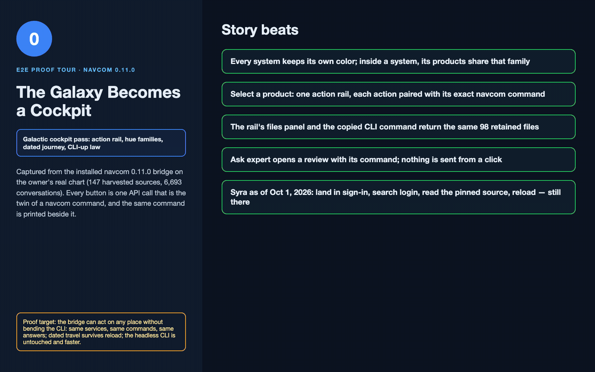

| # | Shot | What it proves |
|---|---|---|
| 01 | 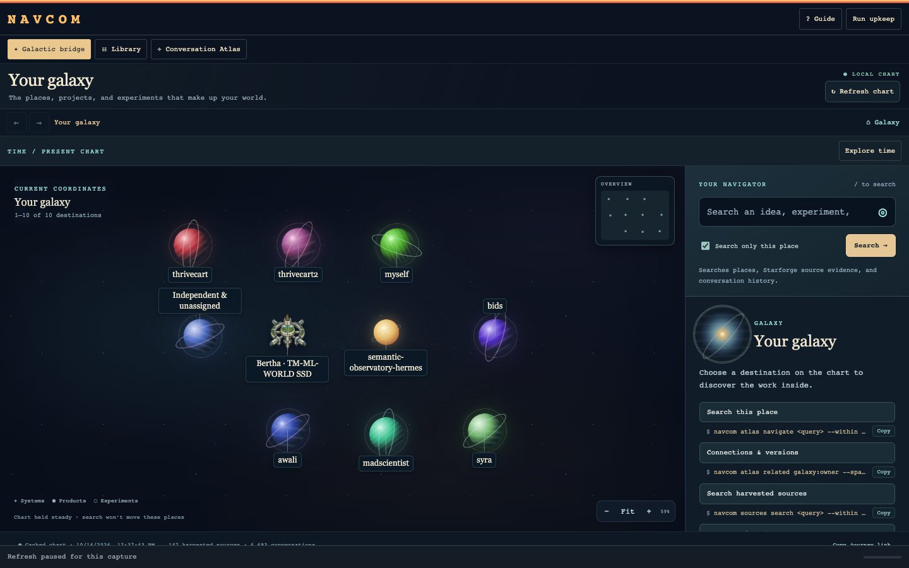 | Each solar system keeps a stable color, which the view derives from its ID. Services carry no color. |
| 02 | 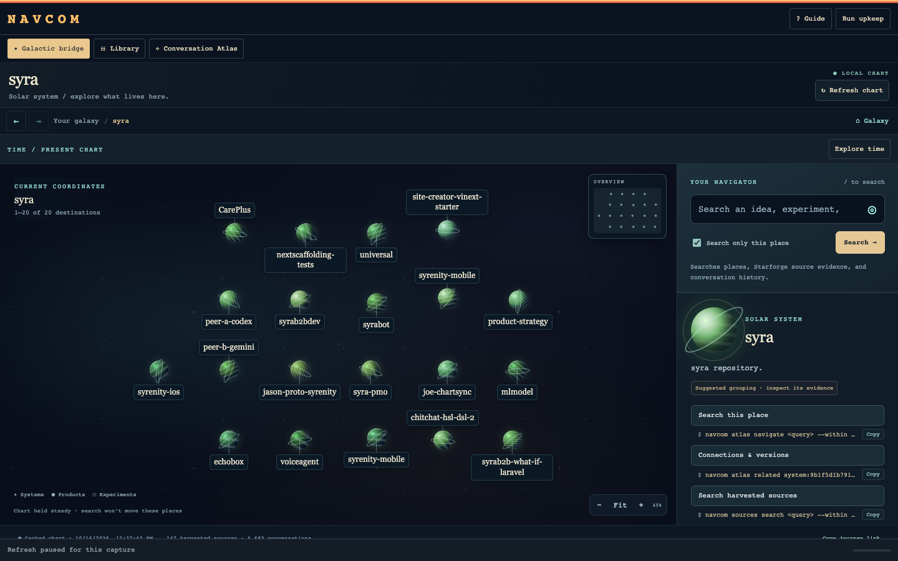 | Inside Syra, every product shares Syra's green family. |
| 03 | 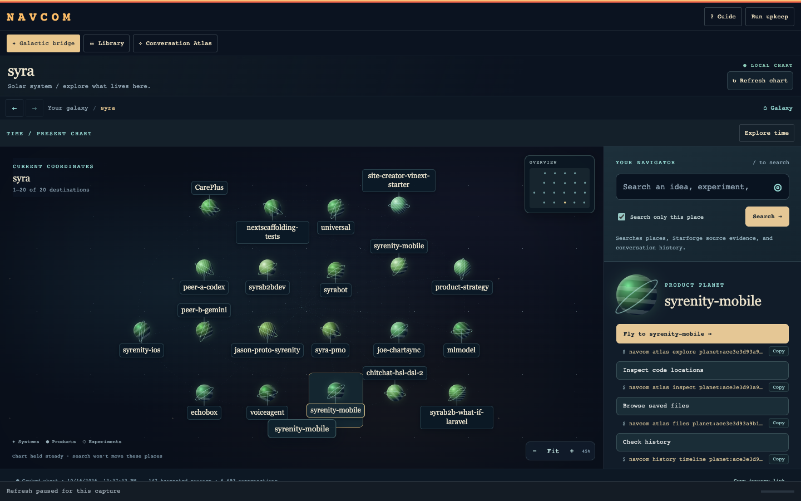 | One action rail. Each action shows the service's own `navcom …` command, with Copy. |
| 04 | 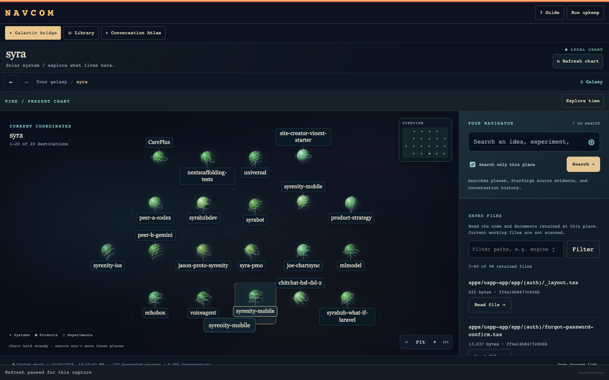 | Browse saved files shows 1–40 of 98 retained files, starting with `_layout.tsx` (625 B). |
| 05 | 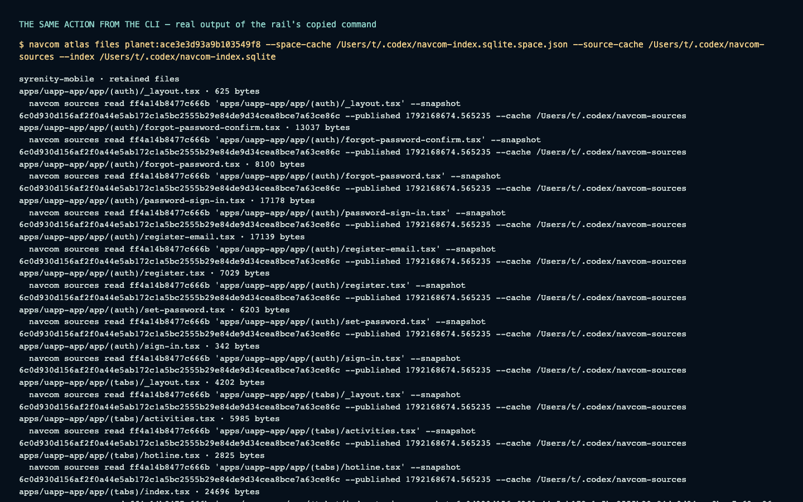 | The copied command, run in a terminal, lists the same files at the same sizes. |
| 06 | 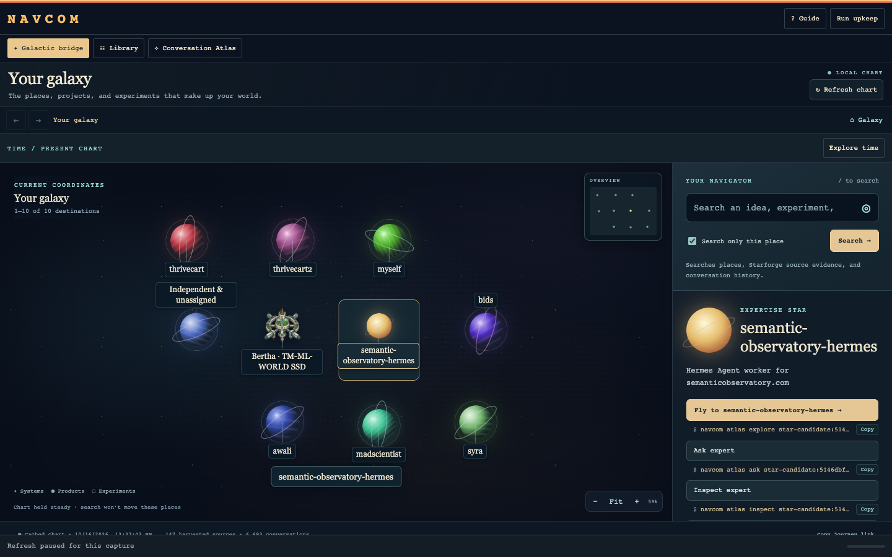 | A living star (Hermes expert) gets the same rail. |
| 07 | 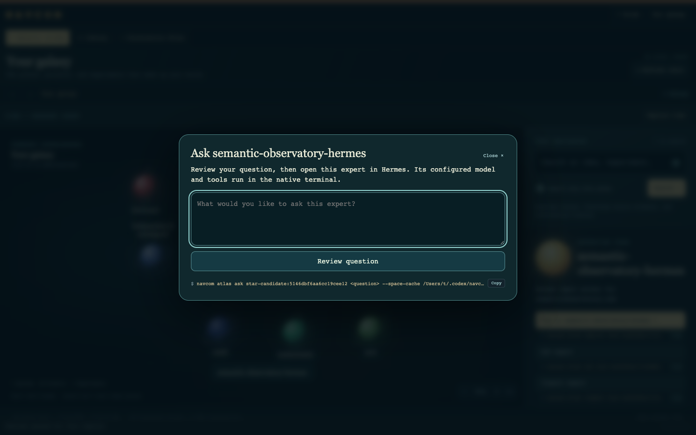 | Ask expert opens a review with its exact command. A click sends nothing. |
| 08 | 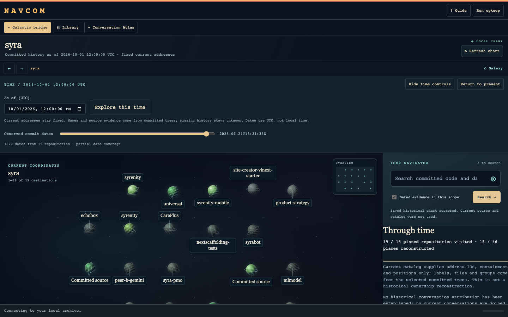 | Syra reconstructed at 2026-10-01 12:00 UTC from the saved pinned session. |
| 09 | 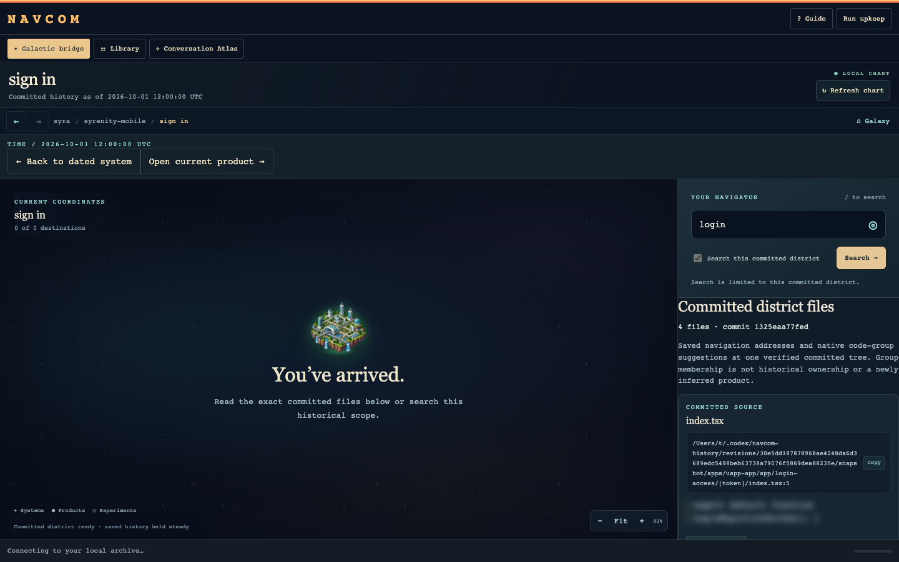 | The committed "sign in" district searched for `login`: only its committed files. |
| 10 | 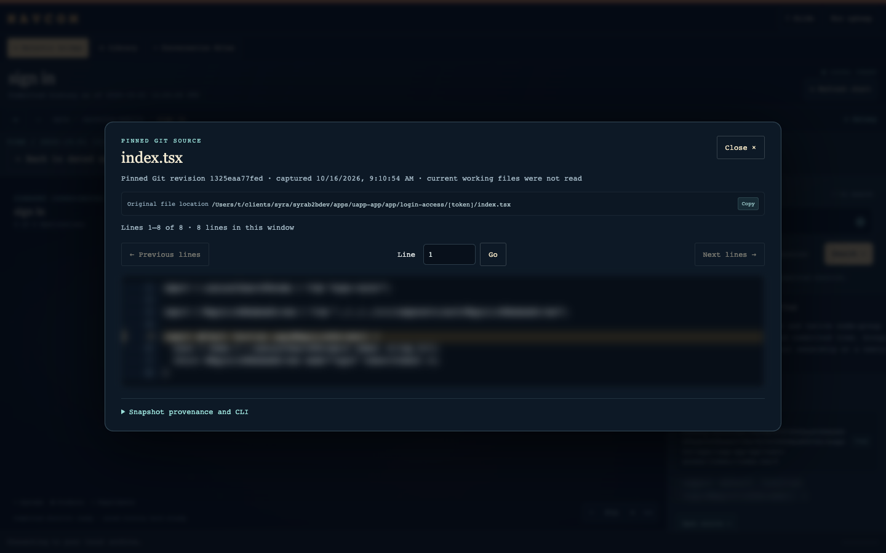 | The original file at pinned commit `1325eaa77fed`, labeled "captured" honestly. |
| 11 |  | After a reload the view is still dated, still in the district, and still on `login`. |
| 12 | 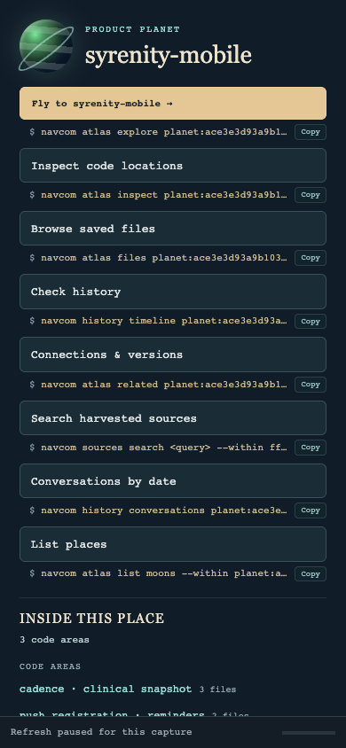 | At 390 px phone width the rail stacks and the commands stay copyable. |
| 13 | 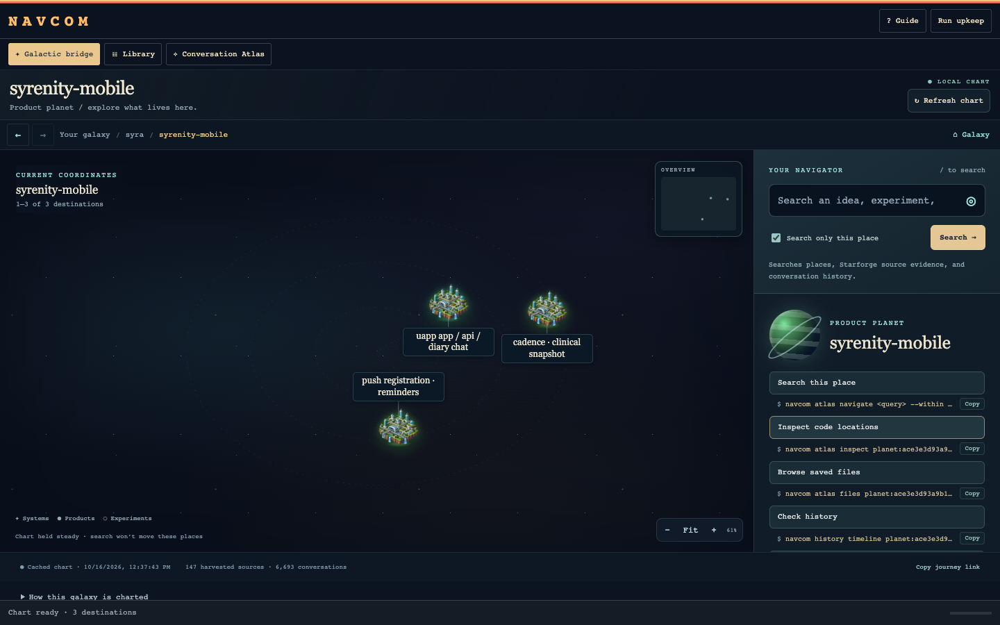 | With reduced motion, arrival is instant and code districts appear as cities. |

## How it was captured

- **Read-only.** The automatic chart refresh got a benign "Refresh paused for
  this capture" reply. Dated requests could only reuse the saved journey cursor;
  anything that would pin a new session was aborted.
- **Privacy.** The repository is public, so source-code bodies, match snippets
  and conversation titles are blurred in every shot. Paths, places, commands and
  structure are not blurred.
- The same journey is asserted live, UI == API, by `tests/test_ui_api_sync.py`:
  7/7 against this bridge, with no cache writes.

## Open findings

- **Live microphone acceptance** is not proved. Voice was deliberately left alone;
  it is meant to become a living star.
- **Captain boarding** is not possible here. Every working ship is hosted on Bertha,
  and boarding needs either a local working ship with an owned captain route and
  a live socket, or a CLI-first remote-attachment concept
  (see `docs/galactic-implementation-plan.md`).
- **Two products in Syra share the label `syrenity-mobile`** (two repository
  copies). They are distinguishable only by their path qualifiers.

## Regenerate

```sh
NAVCOM_BRIDGE_URL=http://127.0.0.1:PORT/ .venv/bin/python scripts/capture_cockpit_tour.py docs/e2e-tours/2026-10-16/galaxy-cockpit
.venv/bin/python scripts/build_tour_gif.py docs/e2e-tours/2026-10-16/galaxy-cockpit
NAVCOM_BRIDGE_URL=http://127.0.0.1:PORT/ .venv/bin/python -m pytest tests/test_ui_api_sync.py -v
```
